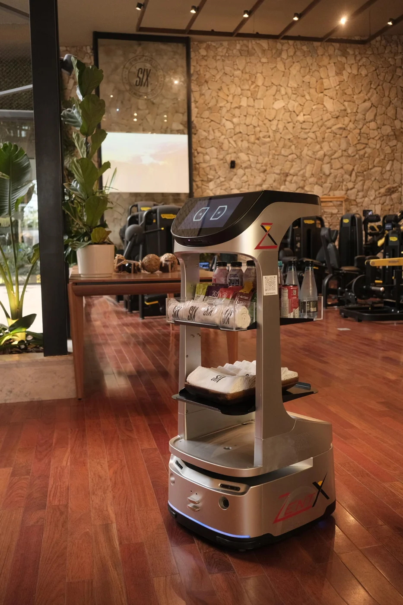
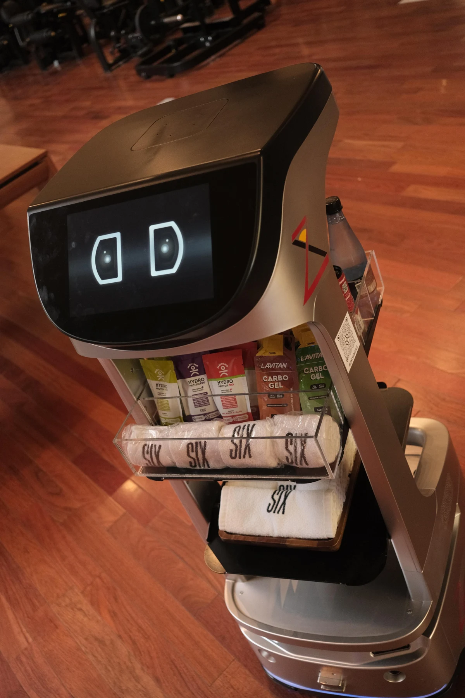

# Zentx Robotics

Site institucional da Zentx Robotics, desenvolvido para apresentar a robótica de serviço e sua aplicação em um ambiente de treino. O objetivo é mostrar a experiência de atendimento com um robô que transporta bebidas e toalhas, por meio de textos, fotografias e vídeo, além de facilitar o contato com a marca.

## Integrantes do grupo

- Bruno Correr Coa
- Gabriel Ferreira dos Reis
- Otávio Esboriol
- Guilherme Coletti da Silva

## Principais funcionalidades

- Página de apresentação da Zentx Robotics.
- Navegação por âncoras para as seções de experiência e demonstração.
- Apresentação das características do robô e de sua atuação no ambiente de treino.
- Vídeo demonstrativo com controles de reprodução.
- Galeria de fotografias com ampliação em uma janela modal.
- Layout responsivo para computadores e dispositivos móveis.
- Links de contato com o perfil [@zentxrobotics no Instagram](https://www.instagram.com/zentxrobotics/).
- Descrições alternativas nas imagens, indicação visual de foco e respeito à preferência por redução de movimento.

## Tecnologias utilizadas

| Tecnologia | Utilização |
| --- | --- |
| PHP | Renderização da página em `api/index.php` e envio dos cabeçalhos HTTP. |
| HTML5 | Estrutura semântica, vídeo e janela de ampliação de imagens. |
| CSS3 | Layout, cores, tipografia, responsividade e efeitos visuais. |
| JavaScript | Abertura e fechamento das imagens da galeria. |
| Google Fonts | Fontes Barlow Condensed e DM Sans. |
| Vercel e vercel-php | Configuração de hospedagem com o runtime comunitário `vercel-php@0.9.0`. |

## Requisitos e dependências

- PHP 7.0 ou superior para os recursos de linguagem utilizados; recomenda-se PHP 8.x para desenvolvimento local.
- Git para clonar o repositório, ou o código baixado como ZIP pelo GitHub.
- Navegador atualizado com suporte a JavaScript, ao elemento `dialog` e à reprodução de vídeo MP4.
- Acesso à internet para carregar o Google Fonts e abrir o Instagram. Os arquivos de imagem, vídeo, estilos e scripts estão no próprio repositório.

Não é necessário instalar pacotes com Composer ou npm, configurar banco de dados ou definir variáveis de ambiente para executar o site localmente.

## Instalação, configuração e execução

### 1. Obter o projeto

```bash
git clone https://github.com/devbrunocc/zentx-robotics.git
cd zentx-robotics
```

Também é possível baixar e extrair o ZIP do repositório e abrir um terminal na pasta extraída.

### 2. Verificar o PHP

```bash
php --version
```

Se o comando não for reconhecido, instale o PHP e adicione seu executável ao PATH do sistema.

### 3. Preparar a entrada local e iniciar o servidor

Na Vercel, a rota `/` é direcionada a `api/index.php` pelo arquivo `vercel.json`. O servidor embutido do PHP não lê essa configuração. Por isso, crie uma cópia local da página na raiz antes de iniciar o servidor:

```bash
php -r "copy('api/index.php', 'index.php');"
php -S localhost:8080 -t .
```

Abra [http://localhost:8080](http://localhost:8080) no navegador. Mantenha o terminal aberto enquanto utiliza o site e pressione `Ctrl+C` para encerrar o servidor.

A cópia `index.php` na raiz serve apenas para a execução local e não precisa ser enviada ao repositório. Caso altere `api/index.php`, repita o comando de cópia para atualizar a versão local. Para remover essa cópia ao terminar:

```bash
php -r "if (is_file('index.php')) { unlink('index.php'); }"
```

A raiz do projeto deve ser a pasta pública do servidor, pois o site utiliza caminhos como `/style.css`, `/app.js` e `/robot.mp4`. Abrir o arquivo PHP diretamente pelo explorador de arquivos não executa o código.

### 4. Personalizar o conteúdo

- Edite `api/index.php` para alterar textos, seções e links.
- Edite `style.css` para ajustar a aparência e o comportamento responsivo.
- Edite `app.js` para modificar a interação da galeria.
- Ao substituir imagens ou o vídeo, mantenha os nomes utilizados pela página ou atualize suas referências.

## Exemplos de funcionamento

1. Na página inicial, clique em **Veja em ação** para ir à seção de vídeo.
2. Use os controles do vídeo para reproduzir ou pausar a demonstração.
3. Na seção **Veja de perto**, clique em uma fotografia para ampliá-la. Feche pelo botão **Fechar ×**, pela tecla `Esc` ou clicando fora da imagem.
4. Reduza a largura da janela para observar a adaptação do layout.
5. Clique em **Converse com a Zentx no Instagram** para acessar o perfil de contato.

### Imagens utilizadas no site

Os registros abaixo são fotografias presentes na página, e não capturas da interface.





[Assistir ao vídeo demonstrativo do projeto](robot.mp4)

## Estrutura do projeto

```text
zentx-robotics/
├── api/
│   └── index.php    # Página principal em PHP
├── app.js           # Interações da galeria
├── style.css        # Estilos e layout responsivo
├── logo.jpg         # Identidade visual
├── 14.webp          # Imagem de capa do vídeo
├── 17.webp          # Fotografia da galeria
├── 25.webp          # Fotografia da seção inicial
├── 26.webp          # Fotografia da galeria
├── 27.webp          # Fotografia dos detalhes
├── 30.webp          # Fotografia da galeria
├── robot.mp4        # Vídeo demonstrativo
├── vercel.json      # Runtime PHP e rota da página inicial
└── README.md        # Documentação do projeto
```

## Configuração de hospedagem

O arquivo `vercel.json` configura a função `api/index.php` com o runtime comunitário `vercel-php@0.9.0` e reescreve a rota `/` para essa função. Essa dependência se aplica à hospedagem na Vercel; a execução local utiliza o PHP instalado na máquina.

## Identidade visual

A logo foi obtida do perfil @zentxrobotics. As cores do site foram aproximadas visualmente a partir dessa logo.
